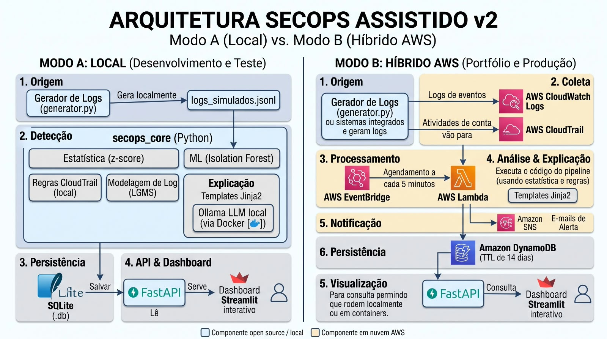

# SecOps Assistido

Detecção de anomalias em logs com explicação assistida. O mesmo núcleo de detecção
(`secops_core`) roda em dois modos: local, para desenvolvimento e teste, e híbrido AWS,
para portfólio e produção.



## Modos

- **Modo A (local):** gerador de logs, detecção em Python (z-score, Isolation Forest,
  regras de CloudTrail e modelagem de log), explicação por templates Jinja2 e Ollama em
  Docker, persistência em SQLite, API FastAPI e dashboard Streamlit.
- **Modo B (híbrido AWS):** CloudWatch Logs e CloudTrail, EventBridge a cada 5 minutos,
  Lambda, SNS para alertas e DynamoDB (TTL de 14 dias), com a mesma API e o mesmo dashboard.

## Status

**Modo A (local): completo.** Gerador, detecção, SQLite, explicação, API e dashboard
funcionam de ponta a ponta, com testes (`make test`) e auditoria de acessibilidade
(`make a11y`). O Modo B (AWS) ainda não foi começado.

## Como funciona

```
gerador ──> logs_simulados.jsonl ──> parser ──> detectores ──> pipeline ──> SQLite
                                                 │  regras CloudTrail          │
                                                 │  Z-Score (volume/hora)      ├──> API FastAPI ──> dashboard
                                                 └  Isolation Forest           │
                                              explicação: templates Jinja2 + Ollama (opcional)
```

1. **Parser** (`parser.py`): valida e normaliza cada evento (`LogEvent`); linha inválida dá erro com o número dela.
2. **Detectores** (`detectors/`): regras (adulteração do log, escalada de privilégio, S3 público, uso do root, 5+ logins falhos seguidos, sucesso de IP externo),
   Z-Score do volume por usuário e hora, e Isolation Forest sobre o comportamento de cada evento.
3. **Pipeline** (`pipeline.py`): roda os três, junta alertas do mesmo usuário com janelas que se
   sobrepõem (fica o mais grave, com os detectores que concordaram) e grava no SQLite.
4. **Explicação** (`explain.py`, `llm.py`): todo alerta tem uma explicação por template Jinja2, na hora.
   Sob demanda, o Ollama acrescenta um resumo da atividade em volta do alerta; se ele falhar, vale o template.

### API

Documentação interativa em `/docs`.

| Endpoint | O que faz |
|---|---|
| `POST /run` | lê `data/logs_simulados.jsonl`, roda os detectores e substitui os alertas |
| `GET /alerts`, `GET /alerts/{id}` | alertas, com filtros `severity`, `detector`, `user`, `rule`, `limit` e `offset` |
| `GET /alerts/{id}/explanation` | explicação por template; `?ai=true` pede também o resumo do Ollama (20 a 90 s) |
| `GET /logs` | logs, com filtros `user`, `action`, `start`, `end`, `limit` e `offset` |
| `GET /metrics` | totais e quebras por gravidade, detector e usuário |

### Limites que você precisa saber

- **Os dados são sintéticos.** O gerador planta as anomalias que as regras conhecem; recall e precisão de
  100% nos testes provam o funcionamento do pipeline, não a detecção de ataques reais.
- **O Isolation Forest gera ruído** (cerca de 8 falsos positivos em 1.000 eventos, sempre `medium`).
  Todo alerta `high` dos testes é um incidente real; filtre por gravidade.
- **O resumo do Ollama não é confiável para dar veredito.** O modelo de 3B em CPU já chamou uma ação
  sensível às 3h de "uso normal". Por isso o prompt só pede a descrição da atividade, e o texto sai
  rotulado como "pode conter erros". O veredito vem das regras e dos templates.
- A primeira chamada ao Ollama pode passar de 90 s (carga do modelo); depois, de 20 a 35 s em CPU.

### Acessibilidade

O dashboard é auditado contra WCAG 2.2 AA num Chromium real, com axe-core, em 1280 px e 320 px:

```bash
make a11y
```

Falha se achar qualquer violação (também confere idioma, títulos, reflow e se os gráficos renderizaram).
Gráficos e tabelas são HTML próprio (`charts.py`): o dado sempre está em texto e o desenho é reforço.
O tema (`.streamlit/config.toml`) garante o contraste. Limites do Streamlit que não dá para corrigir:
os rótulos internos dos controles ("Main menu", "Collapse sidebar") ficam em inglês, e o
`<html lang>` é corrigido por script. Testar com um leitor de tela de verdade (NVDA, VoiceOver) ainda
é necessário: ferramentas automáticas cobrem só parte do WCAG.

## Ambiente

Docker Compose com a pasta do projeto montada nos containers, para hot reload do código.
Python 3.13 e dependências gerenciadas com [uv](https://docs.astral.sh/uv/).

### Primeiro uso

Recomendado: WSL com Ubuntu e o projeto clonado dentro do Linux (`~/projetos`). Em pasta do
Windows funciona, mas sem a cópia das bibliotecas para o editor.

```bash
./start.sh
```

Constrói a imagem, instala as dependências (a partir do `uv.lock`), sobe a API
(<http://localhost:8080>) e o dashboard (<http://localhost:8501>), gera os logs simulados em `data/` e prepara o editor.
Se alguma porta estiver ocupada, troque-a: `API_PORT=9000 DASHBOARD_PORT=9501 ./start.sh`.
Pode ser repetido quando quiser: com o cache, só reconstrói o que mudou.

### Editar o código no VS Code

O `start.sh` copia as bibliotecas da imagem para `.editor-packages/` (ignorada pelo Git,
cerca de 540 MB) e o `.vscode/settings.json` aponta o Pylance para ela. Abrir a pasta no
VS Code já dá autocompletar e nenhum import em vermelho, sem container e sem aviso.
Em pastas do Windows (`C:\`, `D:\` ou `/mnt/...`) essa cópia é pulada, porque é muito lenta.
Depois de mudar dependências, `make build` (ou `make add pkg=<nome>`) atualiza a cópia.

Para rodar testes e depurar pelo editor, use **Dev Containers: Reopen in Container**
(`F1`): ele constrói a imagem se preciso e abre o editor dentro do container.

### Comandos

`make help` lista tudo. Os principais:

| Comando | O que faz |
|---|---|
| `make up` / `make down` | sobe e derruba api e dashboard |
| `make logs` | acompanha os logs |
| `make editor` | atualiza a cópia das bibliotecas usada pelo editor |
| `make generate` | gera `data/logs_simulados.jsonl` com tráfego normal e anomalias marcadas |
| `make llm` | sobe o Ollama e baixa o modelo (`qwen2.5:3b`; `OLLAMA_MODEL=<nome> make llm` troca) |
| `make a11y` | audita a acessibilidade do dashboard (WCAG 2.2 AA) num Chromium; baixa ~2 GB na primeira vez |
| `make test` / `make lint` / `make format` | pytest, ruff check e ruff format no container |
| `make add pkg=<nome>` | adiciona uma dependência e reconstrói a imagem |

### IA local (opcional)

O Ollama fica no profile `llm` do compose, então `./start.sh` não o sobe nem baixa o modelo
(cerca de 2 GB). Sem ele, as explicações dos alertas vêm dos templates Jinja2. Para ligá-lo,
rode `make llm` uma vez; o modelo fica guardado no volume `ollama`.

## Referências

O catálogo de regras de CloudTrail (adulteração do log, escalada de privilégio, S3 público e uso do
root) foi inspirado no projeto [Landoftha/secops_assistido](https://github.com/Landoftha/secops_assistido),
da mesma atividade Mãos na Tech. O código aqui é próprio.
