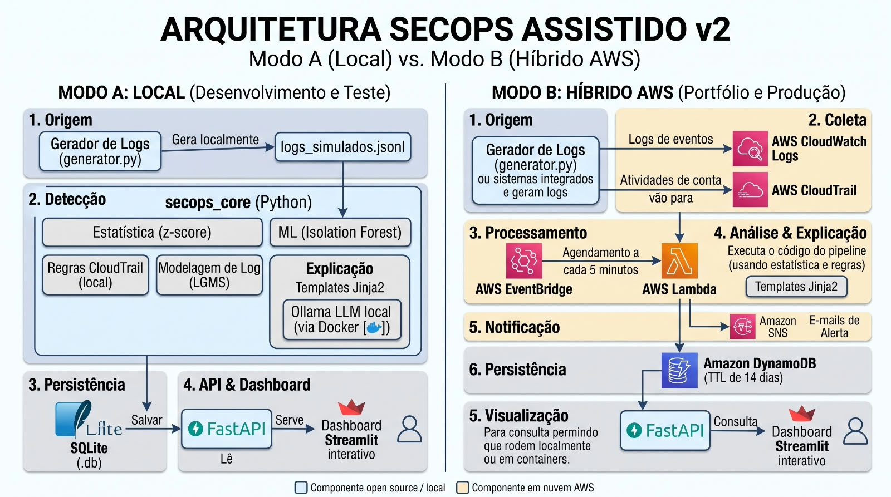

# SecOps Assistido

Detecção de anomalias em logs com explicação assistida. O mesmo núcleo de detecção
(`secops_core`) roda em dois modos: local, para desenvolvimento e teste, e híbrido AWS,
para portfólio e produção.



## Modos

- **Modo A (local):** gerador de logs, detecção em Python (z-score, Isolation Forest,
  regras de CloudTrail e modelagem de log), explicação por templates Jinja2 e Ollama em
  Docker, persistência em SQLite, API FastAPI e dashboard Streamlit.
- **Modo B (híbrido AWS):** CloudWatch Logs e CloudTrail, EventBridge a cada 5 minutos,
  Lambda, SNS para alertas e DynamoDB (TTL de 14 dias), com a mesma API e o mesmo dashboard.

## Status

Em preparação. O trabalho começa pelo Modo A; o Modo B vem depois que o núcleo estiver
funcionando.

## Ambiente

Docker Compose com a pasta do projeto montada nos containers, para hot reload do código.
Python 3.13 e dependências gerenciadas com [uv](https://docs.astral.sh/uv/).

### Primeiro uso

```bash
./start.sh
```

Constrói a imagem, instala as dependências (a partir do `uv.lock`) e sobe a API
(<http://localhost:8000>) e o dashboard (<http://localhost:8501>). Pode ser repetido
quando quiser: com o cache, só reconstrói o que mudou.

Para editar com o mesmo Python e as mesmas bibliotecas dos containers, abra o projeto no
VS Code e use **Dev Containers: Reopen in Container** (`F1`). O serviço `dev` reutiliza a
imagem gerada pelo `start.sh`, por isso ele vem antes.

### Comandos

`make help` lista tudo. Os principais:

| Comando | O que faz |
|---|---|
| `make up` / `make down` | sobe e derruba api e dashboard |
| `make logs` | acompanha os logs |
| `make test` / `make lint` / `make format` | pytest, ruff check e ruff format no container |
| `make add pkg=<nome>` | adiciona uma dependência e reconstrói a imagem |
